# Canon: candlewake

Concept art the owner accepted in the Review Table (`python3 tools/review/review.py canon <batch>`). Each entry gives the
image, the verdict, the note, the prompt, the seat that made it, the batch and the date. Start 3D work from these.
Entries between the `canon:item` markers are rewritten by the next run; write anything else outside them.

<!-- canon:item art_r3/candlewake_capital file=candlewake_capital.png -->
## The Long Vigil, as a place

- **image:** `candlewake_capital.png`
- **verdict:** Good with changes
- **note:** Good general idea, wrong vibe - these are the dead not the living
- **prompt:** Use case: stylized-concept. Asset type: wide cinematic capital-city concept art for a 3D fantasy strategy game. Primary request: The Long Vigil as a real inhabited place, a once-human walled hill city overtaken by the Candlewake. Human-made towers, peaked roofs, arcades and curtain walls have half-melted into enormous candle forms: softened masonry slumps, ivory wax pours down walls and runs in branching streams along streets, rooflines sag like warm tapers, soot-black seams remain beneath. Lilac flames burn in every window and atop some towers. Living townspeople in practical dark clothing share streets and balconies with courteous dead Candlewake people whose humanoid wax bodies carry a small lilac flame on the crown; show ordinary daily life, markets, mourners, children and processions, not an empty ruin. One central keep-height candle rises from the old civic hill, but the city remains recognizably streets, homes and defenses. Bright colourful high fantasy, dark but not grim, painterly concept art with a cel-shaded lean, thick clean silhouettes, saturated ivory, soot black, brass and lilac. Wide elevated cinematic view, Held Sun low on the horizon casting golden light and long violet shadows through wax-bright streets. Original culture, evocative lived-in capital, not a game-piece fortress. No text, letters, captions, labels, signs, runes, numbers, logos, watermark or signature. Avoid real religious architecture, black cube courtyards, antlers, green flame, generic undead hordes, horror gore, recognizable IP.
- **seat:** codex
- **batch:** art_r3
- **date:** 2026-10-07
<!-- /canon:item -->

<!-- canon:item art_r3/candlewake_lineup file=candlewake_lineup.png -->
## The host, model sheet

- **image:** `candlewake_lineup.png`
- **verdict:** Good
- **note:** Change the
- **prompt:** Use case: stylized-concept. Asset type: wide character lineup and model sheet for stylized 3D strategy units. Primary request: Seven Candlewake figures, fully visible head to toe, standing side by side with even spacing on plain warm-gray ground, no overlap. Match the established ivory tallow, soot-black, brass and lilac design language and humanoid people with crown flames. From left: Half-Death, tall divine humanoid with one half of face smooth alabaster and the other half a lilac glowing outline, front-rank presence, no antlers; Mother Tallow, stern older living candlemaker in white shirt and soot apron with brass snuffing shears; the Lamplighter commander, tall wax-skinned humanoid in black high-collared cloak carrying a very tall brass lantern staff; Wickwarden heavy infantry with wax mantle, upright polearm and broad soot shield; Keener lean attacker with hooked mourning blade and streaming lilac ribbons; Great Taper, huge wax monster made from many fused humanoid candles and many small crown flames; a small procession bearer with bell and hand lantern. Every silhouette distinct and readable from a strategy camera. Bright cel-shaded high fantasy, thick even dark outlines, flat saturated colors, one hard shadow and one highlight, original and dark but not grim. Plain neutral backdrop. No text, letters, captions, labels, diagrams, logos, watermark or signature. Avoid candlesticks with faces, skeletons, generic ghosts, green flames, cropped feet, recognizable IP.
- **seat:** codex
- **batch:** art_r3
- **date:** 2026-10-07
<!-- /canon:item -->

<!-- canon:item art_r3/candlewake_melt file=candlewake_melt.png -->
## The melt, in three stages

- **image:** `candlewake_melt.png`
- **verdict:** Good
- **note:** none
- **prompt:** Use case: stylized-concept. Asset type: wide 3D building-swap progression sheet. Primary request: Show the exact same compact human fortress three times side by side from left to right, isolated on three equal plain ground plots, identical high three-quarter strategy camera, identical scale, footprint, curtain wall, gate, four corner towers and central keep. Stage one, just taken: ordinary stone fortress still intact, small ivory candles with lilac flames line battlements and first wax drips appear under windows. Stage two, held a while: the same towers and keep visibly sag, ivory wax sheets cover much of the stone walls, roofs soften, wax runs through the gate, many lilac flames. Stage three, Candlewake heartland: the unmistakable same fortress silhouette fully transformed into a fortress-shaped cluster of enormous ivory candles, battlements softened into wax rims, tower and keep wicks burning lilac, soot-black recesses and brass details. Plain muted grass, clean separation, no people needed, no arrows, dividers, labels or diagrams. Bright colourful high fantasy, dark but not grim, clean cel-shaded 3D concept art, flat saturated colour, thick outlines, one hard shadow and highlight, strong readable silhouettes. Exact continuity across all three panels is essential. No text, letters, captions, labels, symbols, numbers, logos, watermark or signature. Avoid extra fortresses, mismatched camera angles, ruined rubble, green flame, recognizable IP.
- **seat:** codex
- **batch:** art_r3
- **date:** 2026-10-07
<!-- /canon:item -->

<!-- canon:item art_r3/candlewake_tide file=candlewake_tide.png -->
## The tide meets the Crown

- **image:** `candlewake_tide.png`
- **verdict:** Good
- **note:** none
- **prompt:** Use case: stylized-concept. Asset type: wide cinematic battle key art for a 3D fantasy strategy game. Primary request: The Candlewake tide deep in a campaign, an army that burns hotter the longer it fights, crashing from left into a disciplined Aurel Crown line on the right. Candlewake are humanoid dead in ivory wax mantles and soot-black armour, each with a fierce lilac crown flame; front ranks lean forward in a flowing procession, Great Tapers loom like fused candle giants, brass lantern standards and lilac ribbons whip overhead. Their flames are visibly hotter and taller after many battles, lilac light blooming across the clash without becoming an explosion. The Aurel Crown soldiers are ordinary humans in steel, white linen, royal blue and gold, tidy spear-and-shield ranks bracing under blue plumes. Behind the Candlewake, a captured human town is actively becoming wax: masonry houses and gate towers sag, ivory wax runs down streets, lilac flames fill windows, yet living civilians and Candlewake figures remain visible. Held Sun low and golden, strong long shadows, bright colourful high fantasy, dark but not grim, cinematic painterly cel-shaded concept art, bold shapes and readable battle lines. No text, letters, captions, labels, numbers, logos, watermark or signature. Avoid gore, generic skeleton horde, green fire, modern objects, recognizable IP.
- **seat:** codex
- **batch:** art_r3
- **date:** 2026-10-07
<!-- /canon:item -->

<!-- canon:item art_r3b/candlewake_capital file=candlewake_capital__art_r3b.png -->
## The Long Vigil, a city of the dead

- **image:** `candlewake_capital__art_r3b.png`
- **verdict:** Good
- **note:** none
- **prompt:** Cinematic wide painting of the Long Vigil as a city of the dead. A once-human walled city of dripping ivory candle-wax: houses, towers and walls half-melted, wax running down the streets, a lilac flame in every window. On the hill, one candle as tall as a keep burns with a tall lilac flame against a huge low golden sun. The streets are full of the Candlewake host, not the living: hunched figures of dripping ivory tallow with sad human wax faces, a black wick and small lilac flame on every head, soot-black scraps, lilac ribbons, brass snuffer-poles. A Lamplighter with a tall pole walks among them. A Hundred-Wick mound of many melted bodies with a crown of lilac flames. Quiet, mournful, colourful in ivory, soot and lilac. Dark but not grim. Painterly high fantasy. No skulls, no text, no living market.
- **seat:** grok
- **batch:** art_r3b
- **date:** 2026-10-08
<!-- /canon:item -->

<!-- canon:item art_r3c/candlewake_host_eyeless file=candlewake_host_eyeless.png -->
## The wax host, eyeless

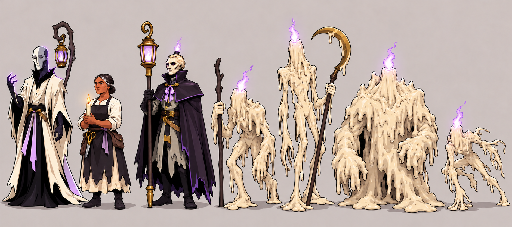

- **image:** `candlewake_host_eyeless.png`
- **verdict:** Good with changes
- **note:** i like these, add variations to make them more war-like and empty shells with hoods of wax to give shape, like in the concept art image The tide meets the Crown
- **prompt:** Edit candlewake_host_eyes.png only in the four pure-wax rank-and-file faces. Remove every lilac eye glint and every dark face opening, flowing matching ivory wax smoothly across each face so it becomes eyeless, featureless, smooth or half-melted solid wax. Preserve the entire canvas as closely as possible outside those four facial areas: exactly the same seven figures, identities, positions, poses, silhouettes, proportions, weapons, clothes on the named characters, wax drips, crown flames, lantern flames, taper flame, colors, outlines, shadows, background, spacing, framing, and resolution. Keep Half-Death, Mother Tallow, and the Lamplighter completely unchanged, including the Lamplighter's lilac eyes. The four troop faces have no eyes, sockets, cavities, glowing facial marks, mouths, noses, teeth, or skull features; their lilac crown flames remain unchanged and are the only face-like beacon. No text, labels, logos, borders, recomposition, restyling, or added figures.
- **seat:** codex
- **batch:** art_r3c
- **date:** 2026-10-08
<!-- /canon:item -->

<!-- canon:item art_r3d/candlewake_host_war file=candlewake_host_war.png -->
## The host as hollow shells, warlike

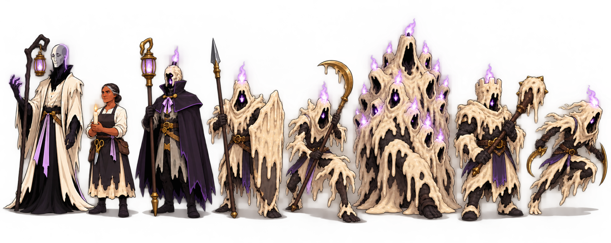

- **image:** `candlewake_host_war.png`
- **verdict:** Good
- **note:** none
- **prompt:** Use case: stylized-concept. Wide strategy-game character model sheet on a plain warm light-gray ground, matching candlewake_tide.png: bright cel-shaded high fantasy, thick clean dark outlines, flat saturated colors, one hard shadow and highlight, bold readable silhouettes. Exactly eight full-body figures: Half-Death with half-finished alabaster face and lilac lantern; Mother Tallow, the sole living warm-brown-skinned woman, with gold taper; the stern wax Lamplighter with brass-capped wick, pole, and lilac lantern; then five warlike rank-and-file hollow shells—a Wickwarden with dripping wax shield and spear, a Gleaner with crescent harvesting hook, the hulking fused Hundred-Wick, a heavy battlement-helmed mace bearer, and a lean swept-back runner with short hooked blades. Every rank-and-file is pure ivory-and-soot poured wax with a distinct wax hood or helm around a completely empty black face cavity, a small lilac wick-light deep inside, lilac rim light, and drips. Armed and aggressive, not sad. All feet visible, no overlap, generous margins. Ivory, soot, plum, lilac, and restrained brass; Mother Tallow's flame alone is gold. No skulls, bones, eyes, masks, black riders, horses, spiked iron crowns, pale blades, text, labels, logos, UI, border, or watermark.
- **seat:** codex
- **batch:** art_r3d
- **date:** 2026-10-08
<!-- /canon:item -->

<!-- canon:item art_r3d/candlewake_shells_heads file=candlewake_shells_heads.png -->
## Hood and helm studies (for 3D)

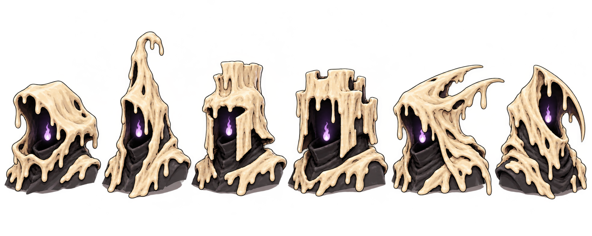

- **image:** `candlewake_shells_heads.png`
- **verdict:** Good
- **note:** none
- **prompt:** Use case: stylized-concept. Wide wordless head study for 3D modelers, matching candlewake_tide.png: bright cel-shaded high fantasy, thick clean outlines, flat saturated colors, hard-edged shadow and highlight, tactile poured wax. Exactly six equal-scale, separated head-and-shoulder busts in consistent three-quarter view on a plain warm light-gray ground. Each head is a hollow shell—not a person, skull, mask, or face—with a distinct thick ivory-and-soot wax hood or helm around a deep empty black cavity, a small lilac wick-light held inside, visible rim thickness, irregular rim drips, layered cooled folds, soot-dark inner surfaces, pooled wax shoulders, and lilac bounce light. Six silhouettes: low rounded drooping cowl; tall bent taper hood; broad squared soldier helm; squat battlement helm; swept-back runner hood with wax fins; asymmetric crescent-rim reaper hood. No living skin, eyes, mouths, noses, teeth, exterior flames, fabric hoods, metal helmets, black riders, horses, spiked crowns, pale blades, text, labels, annotations, logos, UI, border, or watermark.
- **seat:** codex
- **batch:** art_r3d
- **date:** 2026-10-08
<!-- /canon:item -->

<!-- canon:item art_r3e/candlewake_hundred_wick file=candlewake_hundred_wick__codex.png files=candlewake_hundred_wick__codex.png,candlewake_hundred_wick__grok.png -->
## The Hundred-Wick, one fused mass

- **verdict:** Good with changes
- **kept:** 2 takes (a fusion: the note says what to take from each)
- **note:** codex is great a is, but the thought of candlebeasts never struck me before - perhaps these come in many forms
- **batch:** art_r3e
- **date:** 2026-10-08

### Take 1 (codex)

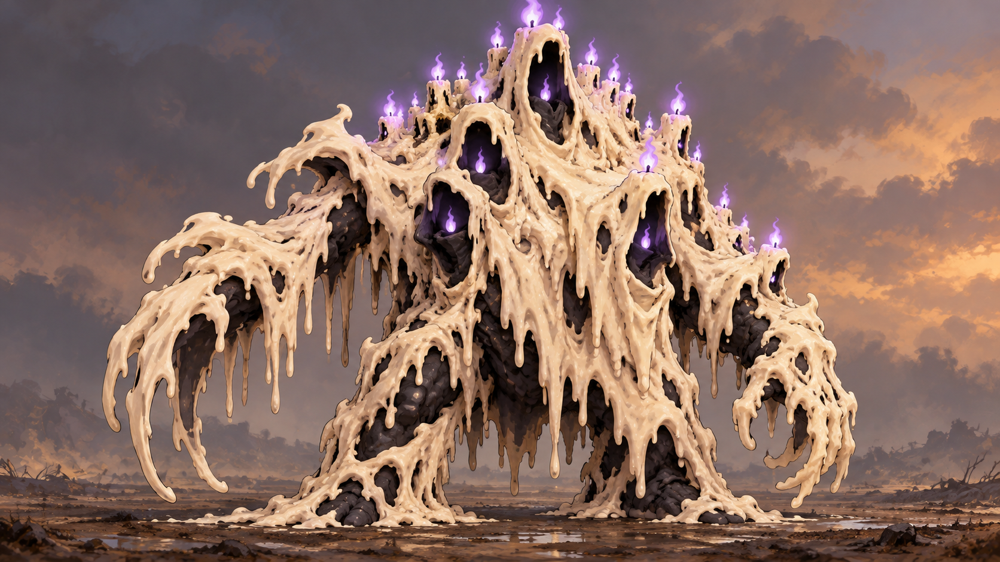

- **image:** `candlewake_hundred_wick__codex.png`
- **seat:** codex
- **prompt:** Wide 16:9 strategy-game boss concept: the Hundred-Wick, exactly one hulking asymmetrical monster formed from many hooded Candlewake shells fused into a single continuous dripping mass, never a pile or stack. Two massive planted legs and long fused arms emerge from an avalanche-like ivory-and-soot wax torso. A crown-like organic cluster of many short black wicks burns with small lilac flames. Three to five black hollow hood openings emerge from the same body, each containing only a tiny lilac wick-light. Painterly high-fantasy creature art matching the supplied Candlewake references, readable at strategy scale, centered and fully visible on plain trampled ground. Opaque background, no text. No purple body, glowing wax, faces, eyes, skulls, metal crown, weapons, riders, horses, or pale blades.

### Take 2 (grok)

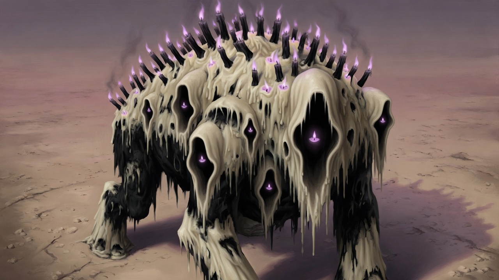

- **image:** `candlewake_hundred_wick__grok.png`
- **seat:** grok
- **prompt:** A single hulking Candlewake monster, the Hundred-Wick, stands alone on a plain dusty earth ground. One fused dripping mass of matte ivory candle wax over a soot-black under-body, many hooded hollow shells melted together into one warlike torso with thick wax legs. A crown of dozens of short black wicks burns small lilac flames along the crest, and a few empty eyeless hood-faces stare out of the dripping flanks, each with a tiny lilac light in the hollow. Painterly oil illustration, cream and charcoal wax, dusk light, wordless.
<!-- /canon:item -->

<!-- canon:item art_r3e/candlewake_march file=candlewake_march__codex.png files=candlewake_march__codex.png,candlewake_march__grok.png -->
## The host on the march (key art)

- **verdict:** Good with changes
- **kept:** 2 takes (a fusion: the note says what to take from each)
- **note:** honestly both are great. grok's is especially haunting.
- **batch:** art_r3e
- **date:** 2026-10-08

### Take 1 (codex)

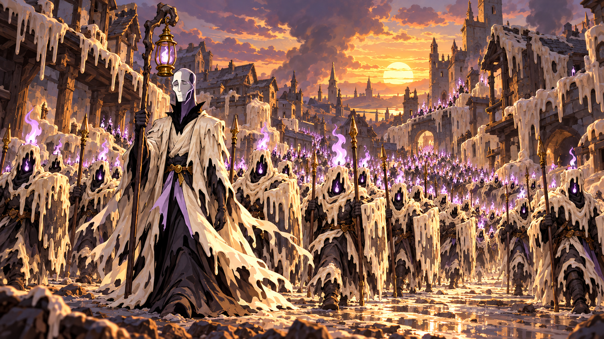

- **image:** `candlewake_march__codex.png`
- **seat:** codex
- **prompt:** Wide 16:9 painterly high-fantasy key art matching candlewake_tide.png: the Candlewake host marches at dusk beneath the unnaturally fixed low Held Sun, emerging from a half-melted timber-and-stone human town coated in cooled ivory wax. Half-Death leads in the front rank, matching candlewake_ruler1.png: tall and unhooded, one half of the long face smooth pale alabaster with closed eye, the other half an empty lilac outline with darkness showing through, tattered ivory robes, soot-black collar, and a brass lantern with lilac flame on a crook. Behind comes an immense warlike tide of hollow eyeless wax soldiers with shields and spears; every hood surrounds pitch-black emptiness with one lilac wick-light. Wick flames rise taller toward the front ranks and diminish deeper in the host. Warm sunset rim light, mournful and inexorable, ivory and soot bodies with lilac only in lantern and wick-fire. Opaque background, no text, no opposing army, riders, horses, spiked iron crowns, bucket helmets, sci-fi visors, or pale blades.

### Take 2 (grok)

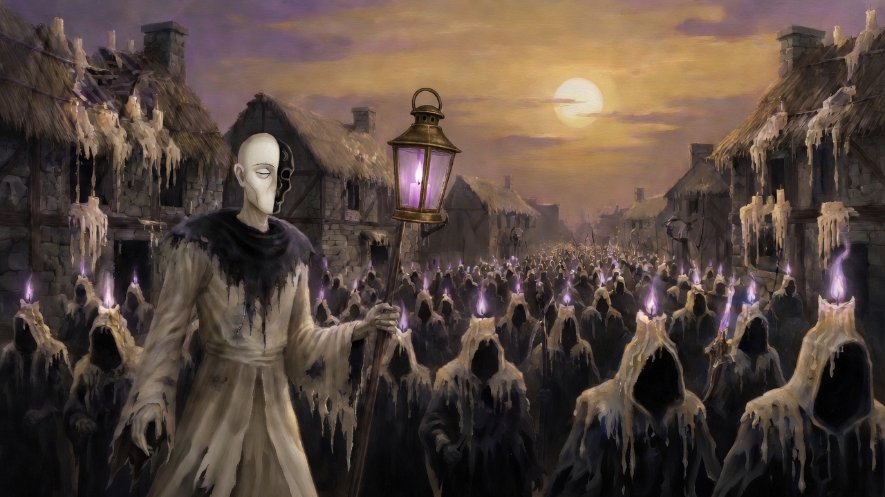

- **image:** `candlewake_march__grok.png`
- **seat:** grok
- **prompt:** Painterly oil key art of the Candlewake host on the march at dusk under a pale Held Sun. Half-Death leads unhooded in the foreground: a tall gaunt god, one half of the face smooth ivory alabaster with a closed eye, the other a thin dark hollow edged in lilac, tattered ivory robes with a soot-black collar, a simple brass lantern with a plain lilac flame. Behind it a tide of hollow hooded ivory-and-soot wax soldiers pours through a half-melted human town whose thatch and stone drip cream wax. Lilac wick-flames burn only inside the empty hoods and on the wicks, taller on the front ranks. Wordless cinematic landscape.
<!-- /canon:item -->

<!-- canon:item art_r3e/candlewake_wickwardens file=candlewake_wickwardens.png -->
## Wickwardens: a squad of five hoods

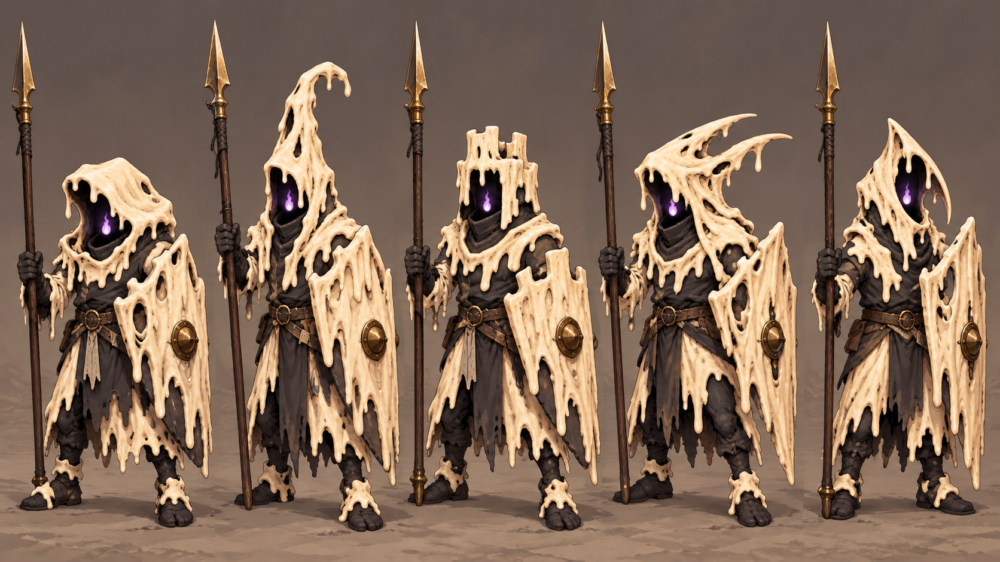

- **image:** `candlewake_wickwardens.png`
- **verdict:** Good
- **note:** none
- **prompt:** Wide 16:9 strategy-game unit concept: exactly five full-body Candlewake Wickwardens stand side by side on plain neutral ground, each holding a simple ivory wax shield and wooden spear. They are eyeless, faceless shells of ivory candle wax over soot-black wrappings, with absolute black hollow interiors containing only one small lilac wick-flame. Give each a clearly different hood silhouette—low slumped cowl, tall bent taper, squared crenellated hood, swept asymmetric hood, narrow pointed shroud—and distinct drip patterns. Painterly high-fantasy strategy art matching the supplied Candlewake references, tactile melted wax, readable silhouettes, slightly elevated three-quarter camera. Ivory and soot only; lilac confined to inner wick-light. Opaque background, no text. No purple bodies, faces, skulls, bucket helmets, sci-fi visors, riders, horses, spiked iron crowns, or pale blades.
- **seat:** codex
- **batch:** art_r3e
- **date:** 2026-10-08
<!-- /canon:item -->

<!-- canon:item art_r3f/candlebeast_guttering_bear file=candlebeast_guttering_bear__codex.png files=candlebeast_guttering_bear__codex.png,candlebeast_guttering_bear__grok.png -->
## The Guttering Bear

- **verdict:** Good with changes
- **kept:** 2 takes (a fusion: the note says what to take from each)
- **note:** both nail the vibe
- **batch:** art_r3f
- **date:** 2026-10-09

### Take 1 (codex)

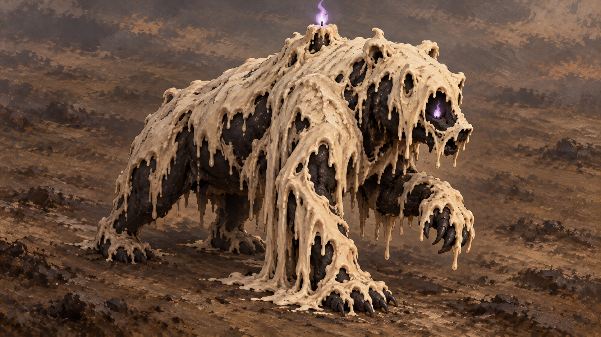

- **image:** `candlebeast_guttering_bear__codex.png`
- **seat:** codex
- **prompt:** Wide 16:9 painterly fantasy strategy-game creature concept art, high three-quarter strategy-camera view. One massive Guttering Bear of soot and ivory wax, visibly mid-melt and slumping as it walks across plain packed umber earth, full body in frame. It rears only a little with one enormous forepaw raised; one shoulder has collapsed into long heavy wax drips nearly touching the ground while the other side still holds its bear shape. A single thick black wick rises from the hump with one small lilac flame. Matte warm ivory wax hangs over a soot-black heavy natural bear body. Each eye position is an empty recessed wax shell containing only a tiny lilac wick-flame, no eyeball or pupil. Painterly oil-brush texture matching the Codex Hundred-Wick reference; tactile, mournful, warlike, never cute. Subdued cloudy atmosphere, readable silhouette, generous margin. No text, letters, logo, border, watermark, UI, people, armor, purple body wax, all-over glow, glossy plastic, skeletons, smoke creatures, or fire elementals.

### Take 2 (grok)

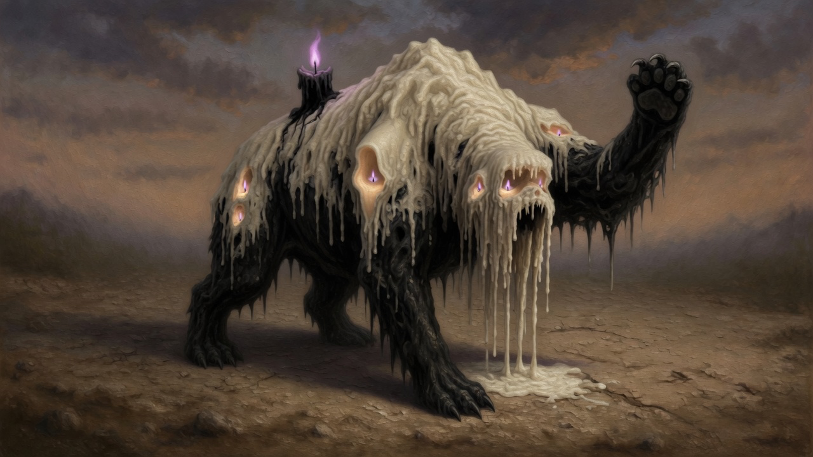

- **image:** `candlebeast_guttering_bear__grok.png`
- **seat:** grok
- **prompt:** A massive bear of soot and ivory candle wax, mid-melt, slumping as it walks across packed earth, rearing a little with one great forepaw raised. High three-quarter strategy-camera view, full body in frame. Painterly ivory-and-soot wax: matte cream tallow poured over a soot-black under-body, one shoulder sagging into long drips that pool on the ground. A thick black wick burns with a small lilac flame from its hump. Hollow eyeless wax shells with a tiny lilac wick-light inside each socket, no glowing eyes. Warlike and a little sad, oil-paint brushwork, matte wax. Wordless, no text.
<!-- /canon:item -->

<!-- canon:item art_r3f/candlebeast_tallow_stag file=candlebeast_tallow_stag__codex.png files=candlebeast_tallow_stag__codex.png,candlebeast_tallow_stag__grok.png -->
## The Tallow Stag

- **verdict:** Good with changes
- **kept:** 2 takes (a fusion: the note says what to take from each)
- **note:** these are both great. grok adding the candles into the rotted out openings is a nice touch.
- **batch:** art_r3f
- **date:** 2026-10-09

### Take 1 (codex)

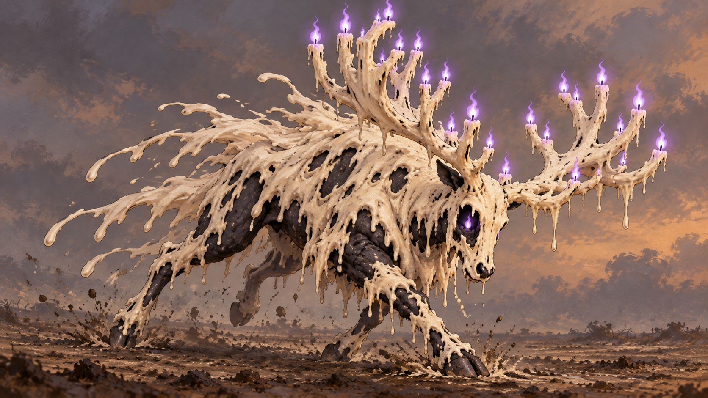

- **image:** `candlebeast_tallow_stag__codex.png`
- **seat:** codex
- **prompt:** Wide 16:9 painterly fantasy strategy-game creature concept art, high three-quarter strategy-camera view. One great Tallow Stag of ivory wax caught in a hard diagonal charge across plain packed umber earth, head lowered and complete body contained in frame. Broadside three-quarter angle clearly shows all four legs and the entire antler span. Huge branching antlers form a natural candelabra of matte wax tines; every terminal point ends in a short black wick with one small lilac flame. Long cooling wax drips stream backward from neck and shoulders like a torn mane. Matte warm ivory tallow is poured over a soot-black natural stag body visible through rents in the wax. Each eye position is an empty recessed wax shell holding only a tiny lilac wick-flame, never an eye or pupil. Painterly oil-brush texture matching the Codex Hundred-Wick reference; powerful, warlike, and sad. Subdued cloudy atmosphere, full silhouette, generous margin. No text, letters, logo, border, watermark, UI, people, armor, purple body wax, all-over glow, glossy plastic, skeletons, smoke creatures, or fire elementals.

### Take 2 (grok)

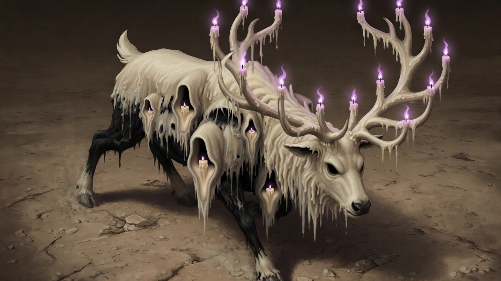

- **image:** `candlebeast_tallow_stag__grok.png`
- **seat:** grok
- **prompt:** A great stag of ivory tallow mid-charge across packed earth, head lowered, full body in a high three-quarter strategy-camera view. Painterly ivory-and-soot wax: matte cream candle wax poured over a soot-black under-body, dripping, half-melted. Its antlers are a branching candelabra of wax tines, a small lilac flame on every point. Long wax drips trail behind it like a mane. Hollow eyeless wax shells with a tiny lilac wick-light inside each socket. Warlike and a little sad. Oil-paint brushwork, matte wax, wordless, no text.
<!-- /canon:item -->

<!-- canon:item art_r3f/candlebeast_wax_hounds file=candlebeast_wax_hounds__codex.png files=candlebeast_wax_hounds__codex.png,candlebeast_wax_hounds__grok.png -->
## Wax Hounds: a pack of three

- **verdict:** Good with changes
- **kept:** 2 takes (a fusion: the note says what to take from each)
- **note:** these are both great. grok adding the candles into the rotted out openings is a nice touch.
- **batch:** art_r3f
- **date:** 2026-10-09

### Take 1 (codex)

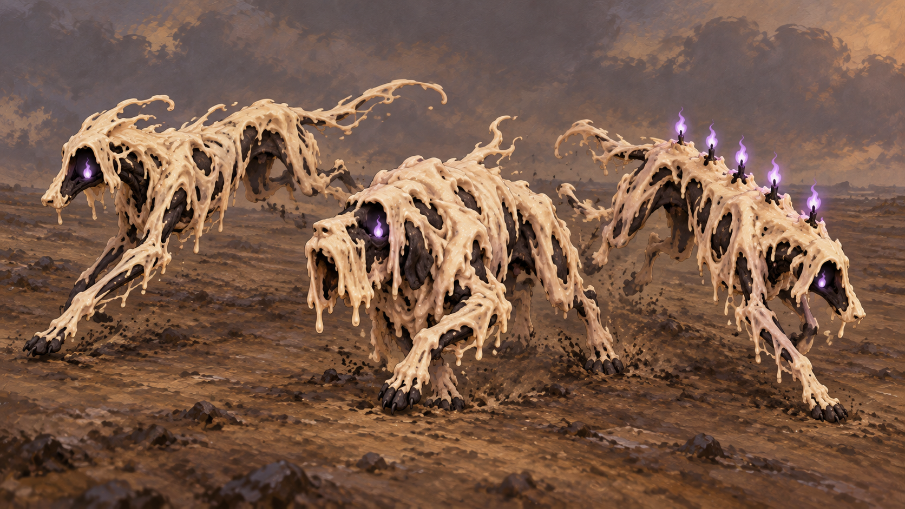

- **image:** `candlebeast_wax_hounds__codex.png`
- **seat:** codex
- **prompt:** Wide 16:9 painterly fantasy strategy-game creature concept art, high three-quarter view from about 35–45 degrees. A pack of exactly three lean hunting hounds of poured wax sprint low and fast together mid-lope across plain packed umber earth, every full body visible and separated enough to read. One hound is lean and very long; one is heavier with a drooping jowl of wax; one has a ridge of short black wicks down its spine. Matte warm ivory candle wax lies in irregular half-melted sheets over soot-black animal bodies. Where each eye would be is an empty recessed wax shell containing only a tiny lilac wick-flame, with no eyeball or pupil. Small restrained lilac flames burn from the beasts, including the dorsal wick ridge. Painterly oil-brush texture matching the Codex Hundred-Wick reference; tactile, warlike, mournful, never cute. Sparse subdued cloudy backdrop, full silhouettes, generous margin. No text, letters, logo, border, watermark, UI, people, armor, collars, purple body wax, all-over glow, glossy plastic, skeletons, smoke wolves, or fire elementals.

### Take 2 (grok)

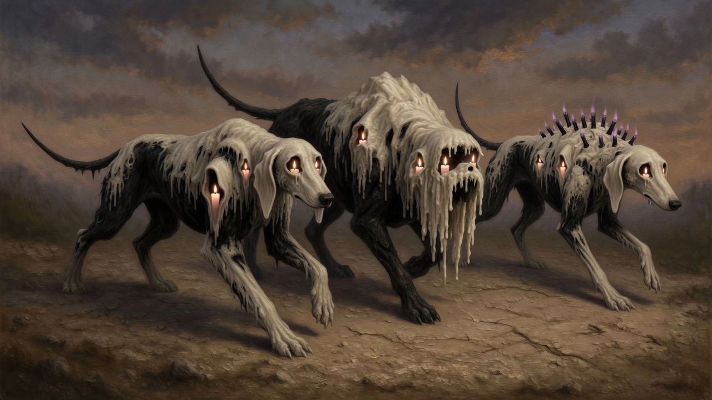

- **image:** `candlebeast_wax_hounds__grok.png`
- **seat:** grok
- **prompt:** A pack of three lean hunting hounds of poured candle wax, mid-lope across packed brown earth, high three-quarter strategy-camera view with every full body in frame. Painterly oil-paint: matte ivory tallow poured over soot-black under-bodies, dripping and half-melted at the edges. One hound long and gaunt, one heavier with a drooping jowl of wax, one with a ridge of short black wicks down its spine. Hollow eyeless wax shells with a small lilac wick-light inside each socket; small lilac flames only on the wicks and inside the hollows. Warlike and a little sad. Dusky painterly sky. Wordless pictorial image, no text or lettering.
<!-- /canon:item -->
