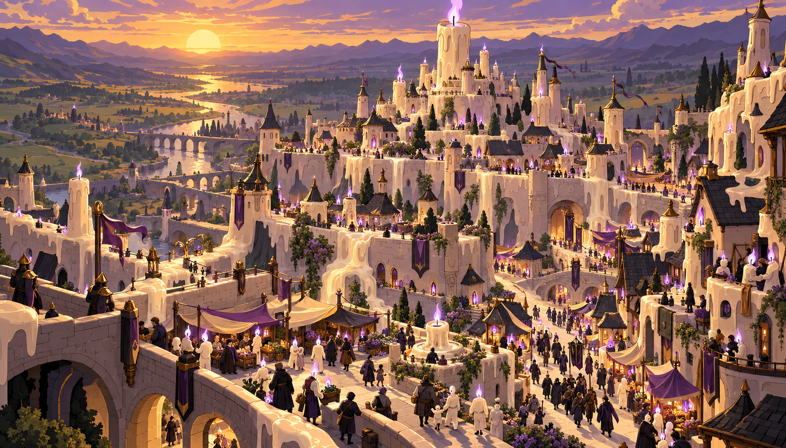
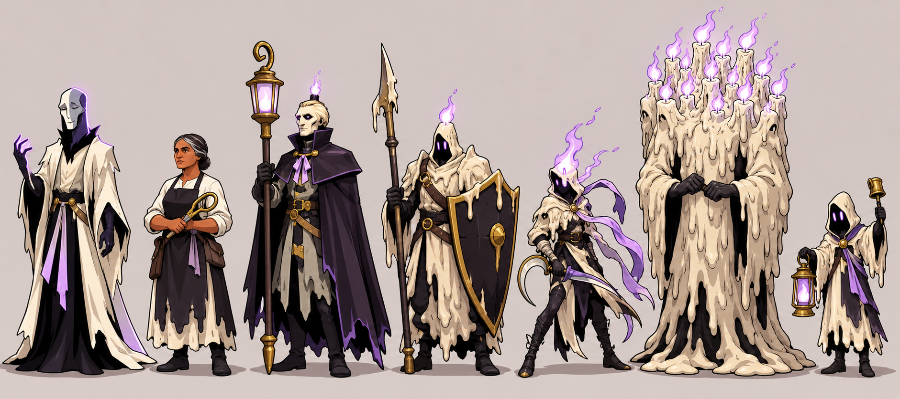
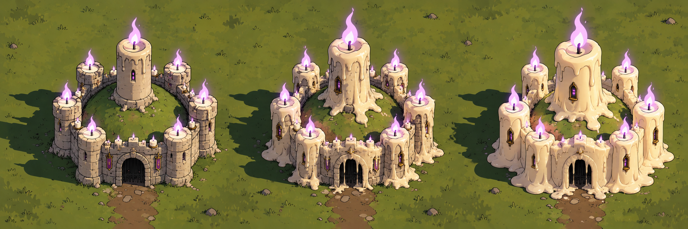
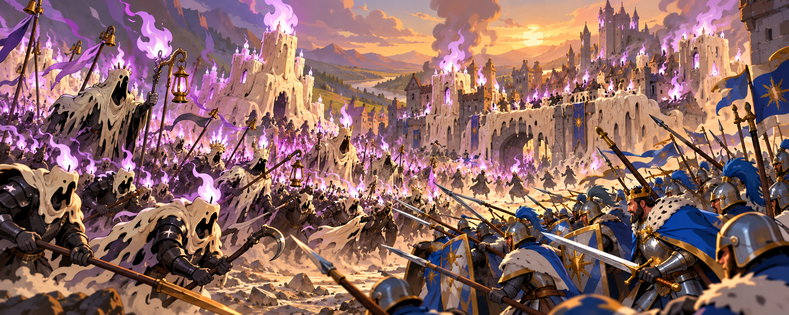
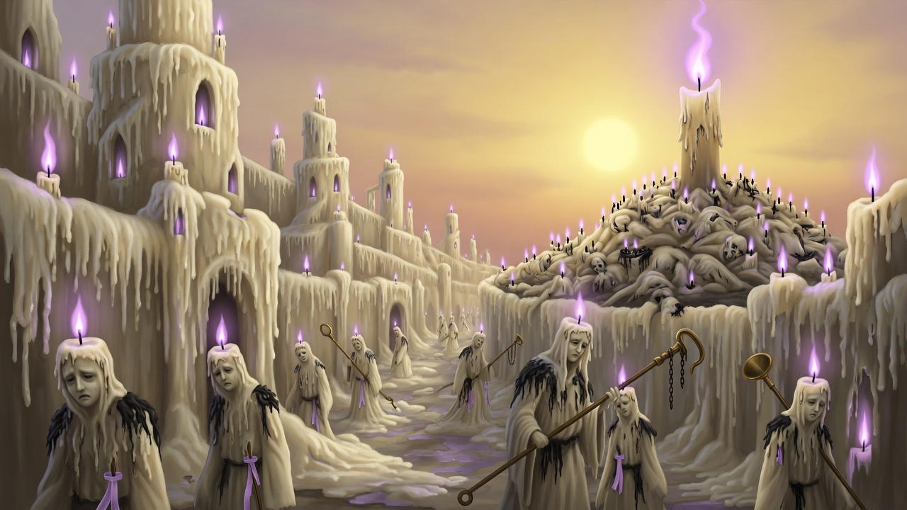

# Canon: candlewake

Concept art the owner accepted in the Review Table (`python3 tools/review/review.py canon <batch>`). Each entry gives the
image, the verdict, the note, the prompt, the seat that made it, the batch and the date. Start 3D work from these.
Entries between the `canon:item` markers are rewritten by the next run; write anything else outside them.

<!-- canon:item art_r3/candlewake_capital file=candlewake_capital.png -->
## The Long Vigil, as a place

- **image:** `candlewake_capital.png`
- **verdict:** Good with changes
- **note:** Good general idea, wrong vibe - these are the dead not the living
- **prompt:** Use case: stylized-concept. Asset type: wide cinematic capital-city concept art for a 3D fantasy strategy game. Primary request: The Long Vigil as a real inhabited place, a once-human walled hill city overtaken by the Candlewake. Human-made towers, peaked roofs, arcades and curtain walls have half-melted into enormous candle forms: softened masonry slumps, ivory wax pours down walls and runs in branching streams along streets, rooflines sag like warm tapers, soot-black seams remain beneath. Lilac flames burn in every window and atop some towers. Living townspeople in practical dark clothing share streets and balconies with courteous dead Candlewake people whose humanoid wax bodies carry a small lilac flame on the crown; show ordinary daily life, markets, mourners, children and processions, not an empty ruin. One central keep-height candle rises from the old civic hill, but the city remains recognizably streets, homes and defenses. Bright colourful high fantasy, dark but not grim, painterly concept art with a cel-shaded lean, thick clean silhouettes, saturated ivory, soot black, brass and lilac. Wide elevated cinematic view, Held Sun low on the horizon casting golden light and long violet shadows through wax-bright streets. Original culture, evocative lived-in capital, not a game-piece fortress. No text, letters, captions, labels, signs, runes, numbers, logos, watermark or signature. Avoid real religious architecture, black cube courtyards, antlers, green flame, generic undead hordes, horror gore, recognizable IP.
- **seat:** codex
- **batch:** art_r3
- **date:** 2026-10-07
<!-- /canon:item -->

<!-- canon:item art_r3/candlewake_lineup file=candlewake_lineup.png -->
## The host, model sheet

- **image:** `candlewake_lineup.png`
- **verdict:** Good
- **note:** Change the
- **prompt:** Use case: stylized-concept. Asset type: wide character lineup and model sheet for stylized 3D strategy units. Primary request: Seven Candlewake figures, fully visible head to toe, standing side by side with even spacing on plain warm-gray ground, no overlap. Match the established ivory tallow, soot-black, brass and lilac design language and humanoid people with crown flames. From left: Half-Death, tall divine humanoid with one half of face smooth alabaster and the other half a lilac glowing outline, front-rank presence, no antlers; Mother Tallow, stern older living candlemaker in white shirt and soot apron with brass snuffing shears; the Lamplighter commander, tall wax-skinned humanoid in black high-collared cloak carrying a very tall brass lantern staff; Wickwarden heavy infantry with wax mantle, upright polearm and broad soot shield; Keener lean attacker with hooked mourning blade and streaming lilac ribbons; Great Taper, huge wax monster made from many fused humanoid candles and many small crown flames; a small procession bearer with bell and hand lantern. Every silhouette distinct and readable from a strategy camera. Bright cel-shaded high fantasy, thick even dark outlines, flat saturated colors, one hard shadow and one highlight, original and dark but not grim. Plain neutral backdrop. No text, letters, captions, labels, diagrams, logos, watermark or signature. Avoid candlesticks with faces, skeletons, generic ghosts, green flames, cropped feet, recognizable IP.
- **seat:** codex
- **batch:** art_r3
- **date:** 2026-10-07
<!-- /canon:item -->

<!-- canon:item art_r3/candlewake_melt file=candlewake_melt.png -->
## The melt, in three stages

- **image:** `candlewake_melt.png`
- **verdict:** Good
- **note:** none
- **prompt:** Use case: stylized-concept. Asset type: wide 3D building-swap progression sheet. Primary request: Show the exact same compact human fortress three times side by side from left to right, isolated on three equal plain ground plots, identical high three-quarter strategy camera, identical scale, footprint, curtain wall, gate, four corner towers and central keep. Stage one, just taken: ordinary stone fortress still intact, small ivory candles with lilac flames line battlements and first wax drips appear under windows. Stage two, held a while: the same towers and keep visibly sag, ivory wax sheets cover much of the stone walls, roofs soften, wax runs through the gate, many lilac flames. Stage three, Candlewake heartland: the unmistakable same fortress silhouette fully transformed into a fortress-shaped cluster of enormous ivory candles, battlements softened into wax rims, tower and keep wicks burning lilac, soot-black recesses and brass details. Plain muted grass, clean separation, no people needed, no arrows, dividers, labels or diagrams. Bright colourful high fantasy, dark but not grim, clean cel-shaded 3D concept art, flat saturated colour, thick outlines, one hard shadow and highlight, strong readable silhouettes. Exact continuity across all three panels is essential. No text, letters, captions, labels, symbols, numbers, logos, watermark or signature. Avoid extra fortresses, mismatched camera angles, ruined rubble, green flame, recognizable IP.
- **seat:** codex
- **batch:** art_r3
- **date:** 2026-10-07
<!-- /canon:item -->

<!-- canon:item art_r3/candlewake_tide file=candlewake_tide.png -->
## The tide meets the Crown

- **image:** `candlewake_tide.png`
- **verdict:** Good
- **note:** none
- **prompt:** Use case: stylized-concept. Asset type: wide cinematic battle key art for a 3D fantasy strategy game. Primary request: The Candlewake tide deep in a campaign, an army that burns hotter the longer it fights, crashing from left into a disciplined Aurel Crown line on the right. Candlewake are humanoid dead in ivory wax mantles and soot-black armour, each with a fierce lilac crown flame; front ranks lean forward in a flowing procession, Great Tapers loom like fused candle giants, brass lantern standards and lilac ribbons whip overhead. Their flames are visibly hotter and taller after many battles, lilac light blooming across the clash without becoming an explosion. The Aurel Crown soldiers are ordinary humans in steel, white linen, royal blue and gold, tidy spear-and-shield ranks bracing under blue plumes. Behind the Candlewake, a captured human town is actively becoming wax: masonry houses and gate towers sag, ivory wax runs down streets, lilac flames fill windows, yet living civilians and Candlewake figures remain visible. Held Sun low and golden, strong long shadows, bright colourful high fantasy, dark but not grim, cinematic painterly cel-shaded concept art, bold shapes and readable battle lines. No text, letters, captions, labels, numbers, logos, watermark or signature. Avoid gore, generic skeleton horde, green fire, modern objects, recognizable IP.
- **seat:** codex
- **batch:** art_r3
- **date:** 2026-10-07
<!-- /canon:item -->

<!-- canon:item art_r3b/candlewake_capital file=candlewake_capital__art_r3b.png -->
## The Long Vigil, a city of the dead

- **image:** `candlewake_capital__art_r3b.png`
- **verdict:** Good
- **note:** none
- **prompt:** Cinematic wide painting of the Long Vigil as a city of the dead. A once-human walled city of dripping ivory candle-wax: houses, towers and walls half-melted, wax running down the streets, a lilac flame in every window. On the hill, one candle as tall as a keep burns with a tall lilac flame against a huge low golden sun. The streets are full of the Candlewake host, not the living: hunched figures of dripping ivory tallow with sad human wax faces, a black wick and small lilac flame on every head, soot-black scraps, lilac ribbons, brass snuffer-poles. A Lamplighter with a tall pole walks among them. A Hundred-Wick mound of many melted bodies with a crown of lilac flames. Quiet, mournful, colourful in ivory, soot and lilac. Dark but not grim. Painterly high fantasy. No skulls, no text, no living market.
- **seat:** grok
- **batch:** art_r3b
- **date:** 2026-10-08
<!-- /canon:item -->
