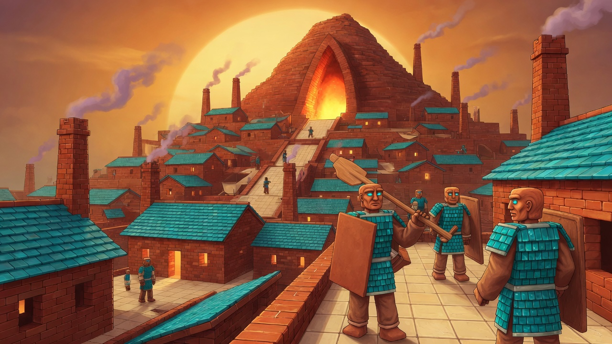
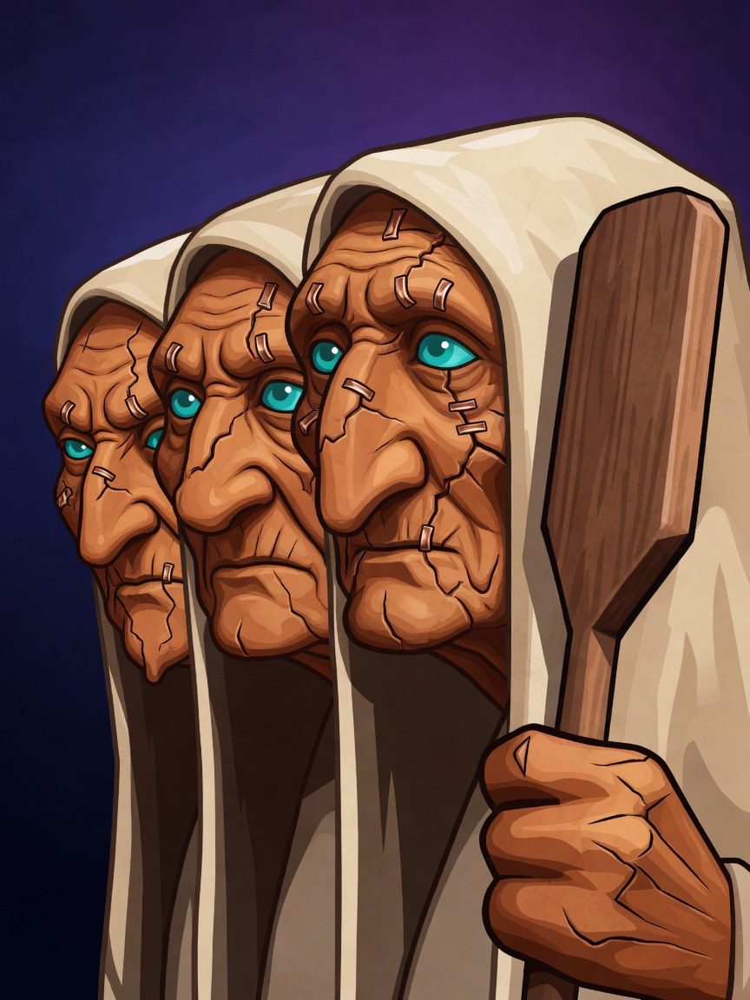
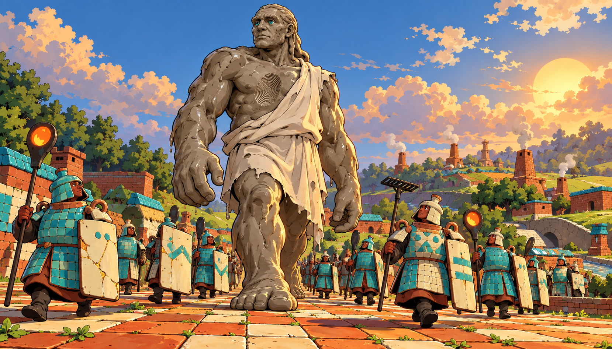

# Canon: kilnborn

Concept art the owner accepted in the Review Table (`python3 tools/review/review.py canon <batch>`). Each entry gives the
image, the verdict, the note, the prompt, the seat that made it, the batch and the date. Start 3D work from these.
Entries between the `canon:item` markers are rewritten by the next run; write anything else outside them.

<!-- canon:item art_r3/kilnborn_capital file=kilnborn_capital.png -->
## The Great Kiln, as a place

- **image:** `kilnborn_capital.png`
- **verdict:** Good
- **note:** none
- **prompt:** Cinematic concept art of the Great Kiln, a hill-sized kiln city where people of fired clay live, under a huge low golden sun. Stepped terraces of red-orange brick houses with glossy turquoise tile roofs climb the brick mountain. A huge pointed kiln mouth glows orange at the heart of the city and never goes dark, and tall square brick chimneys trail thin smoke. Cream-tiled streets and courts run between workshops and open windows. Tall square-shouldered people with warm terracotta skin, bright turquoise eyes and turquoise shingle-tile armour walk with their neighbours, carrying flat rectangular slab shields and long kiln paddles. Copper staples glint in old cracks. No jars, no bottles, no round pots used as bodies. Bright colourful high fantasy, dark but not grim, painterly with a cel-shaded lean, thick outlines, saturated terracotta, turquoise, cream and orange. No text, no letters, no captions. Then edited: Keep the kiln city, the turquoise roofs, the glowing arched mouth, the chimneys, the tiled streets and the low golden sun. Repaint the people as tall human-proportioned fired-clay folk with sculpted human faces, warm terracotta skin, bright turquoise eyes, and armour of glossy turquoise roof tiles. They carry flat rectangular slab shields and long kiln paddles. Human faces, not blocks, not cubes and not robots. No text.
- **seat:** grok
- **batch:** art_r3
- **date:** 2026-10-07
<!-- /canon:item -->

<!-- canon:item art_r3/kilnborn_kiln_mothers file=kilnborn_kiln_mothers.png -->
## The Kiln-Mothers, redone

- **image:** `kilnborn_kiln_mothers.png`
- **verdict:** Good
- **note:** none
- **prompt:** Keep the plain softly graded deep indigo background, the thick clean dark outlines, and the flat saturated cel-shaded colour. Repaint this as three different very old women of fired clay, head and shoulders, three-quarter view facing left, faces large in the upper half. Warm terracotta orange-brown clay skin, deep wrinkles, bright turquoise eyes, long cream-glazed hoods, and old cracks mended with small copper staples. The front woman has a long hooked nose and holds a wooden kiln paddle. The middle woman has a broad flat face and a wide mouth. The woman furthest back has a small pointed chin and narrower eyes. Three separate elders standing shoulder to shoulder, kind and severe, not copies of one face. No text, no letters, no symbols. Edited from the round-2 Kiln-Mothers portrait.
- **seat:** grok
- **batch:** art_r3
- **date:** 2026-10-07
<!-- /canon:item -->

<!-- canon:item art_r3/kilnborn_unfired file=kilnborn_unfired.png -->
## The Unfired, full figure

- **image:** `kilnborn_unfired.png`
- **verdict:** Good
- **note:** none
- **prompt:** Use case: stylized-concept. Asset type: wide full-figure ruler scale concept for a 3D fantasy strategy game. Primary request: The Unfired shown full figure, a gentle colossal humanoid of soft wet grey-brown clay, as tall as a house, walking among many small fired Kilnborn soldiers who reach only its shins. The giant has a heavy sagging brow, bright turquoise eyes, long folds and drips of glossy wet clay, finger dents and pressure ridges across shoulders and arms, rough cream cloth draped over one shoulder, no armour. Make one unmistakable stranger's thumbprint pressed deep into the giant's chest, lit by the low Held Sun. The small soldiers are people inside fired terracotta ceramic shells with human eyes in raised collars, turquoise tile armour, broad jar-like silhouettes, lid helmets, loop-handle pauldrons, cream slab shields, family glaze dots and chevrons, cracks mended in gold; never walking pots with painted faces. They look upward with trust and unease while marching across partly fired square-tiled ground. Bright colourful high fantasy, dark but not grim, cinematic cel-shaded concept art, thick clean outlines, flat saturated terracotta, turquoise, cream and wet clay, strong scale contrast, wide low-angle framing that includes the giant's entire feet and head. No text, letters, captions, labels, runes, logos, watermark or signature. Avoid Buddha imagery, stone giant, cute pottery, realistic terracotta army, recognizable IP.
- **seat:** codex
- **batch:** art_r3
- **date:** 2026-10-07
<!-- /canon:item -->
