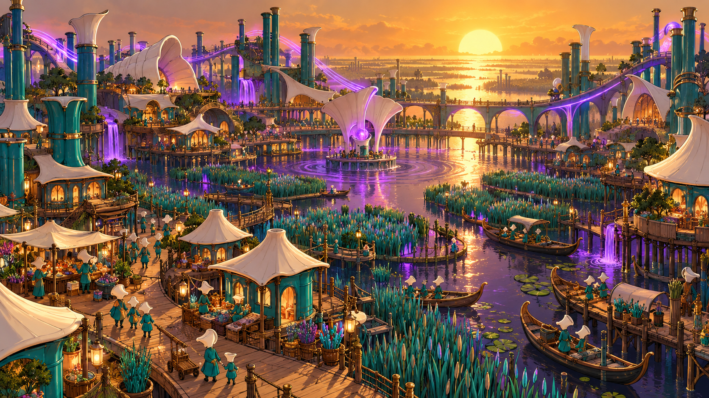
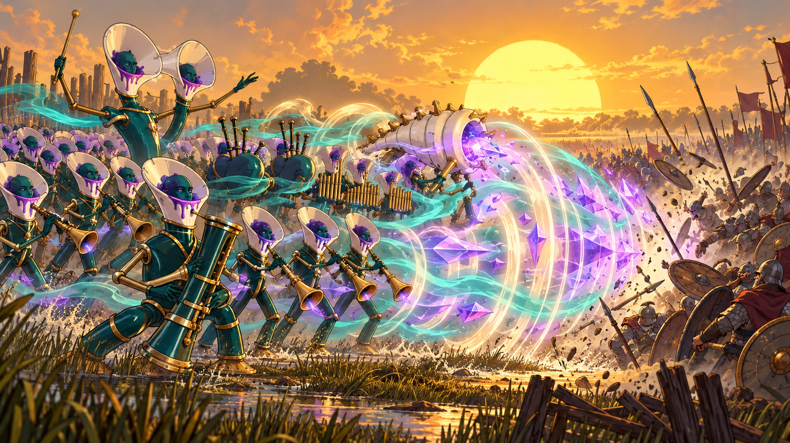
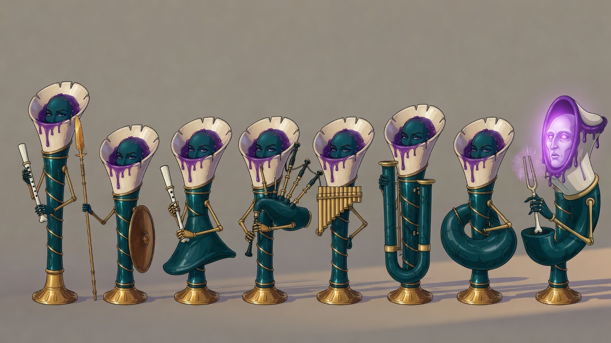
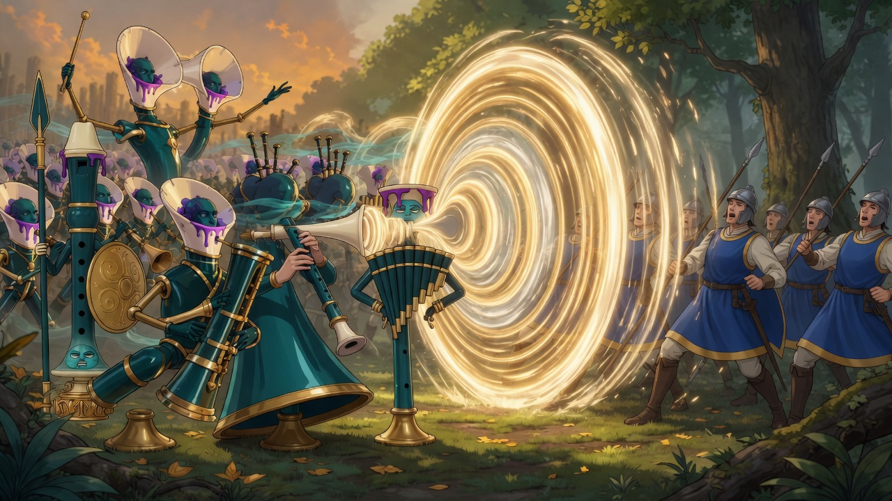
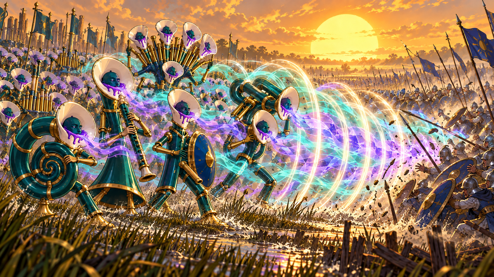
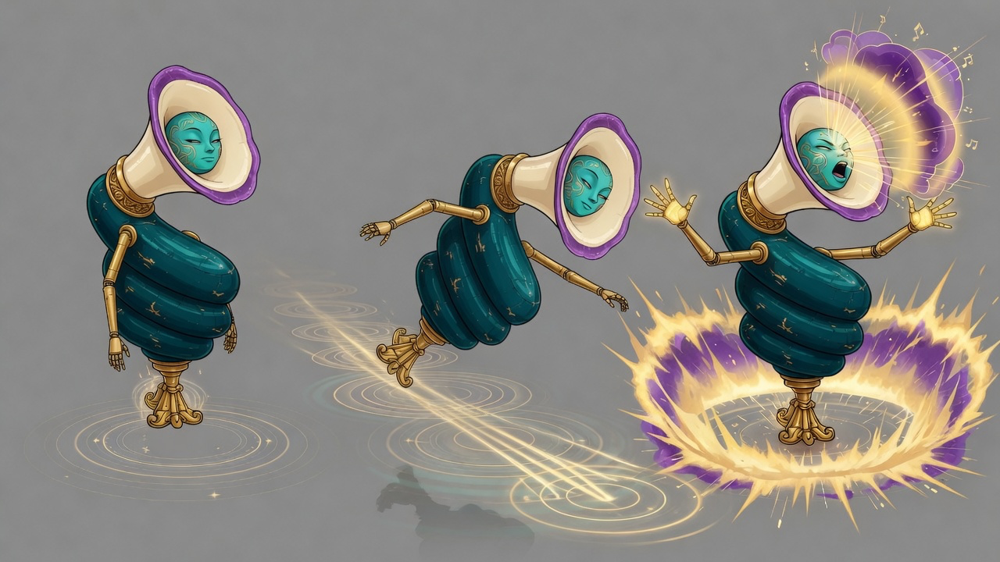
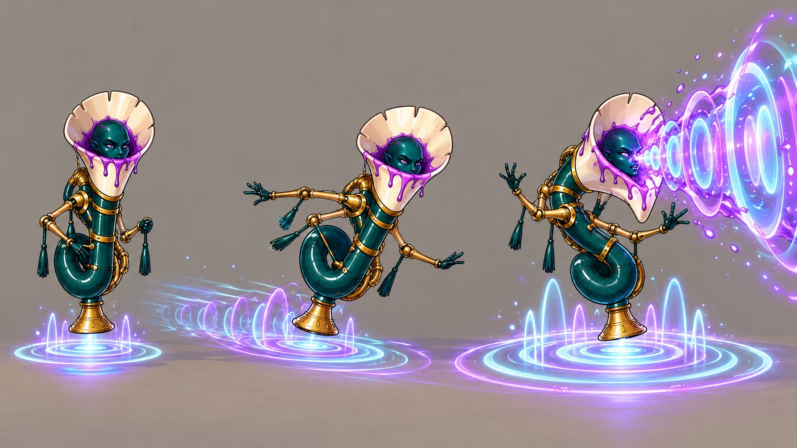
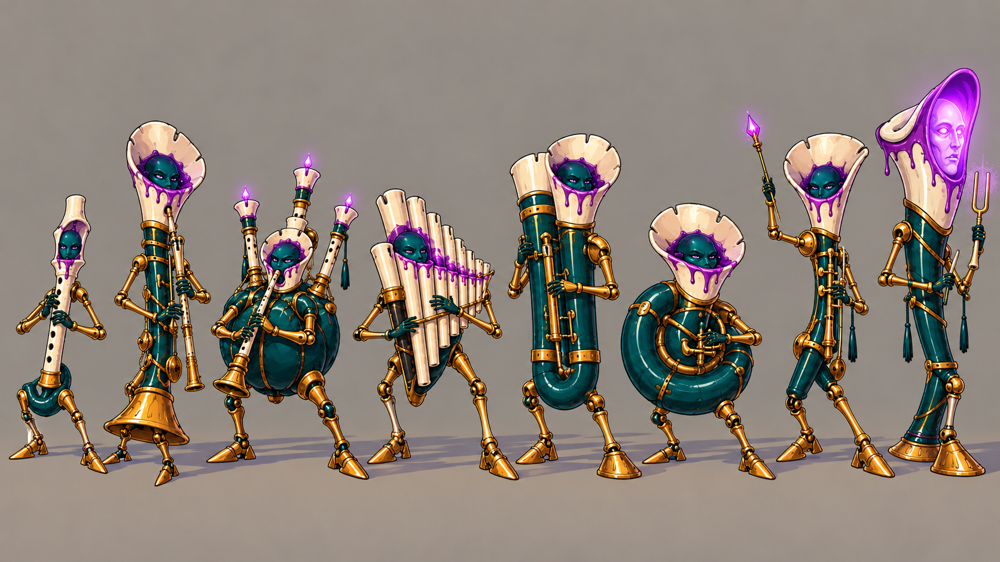
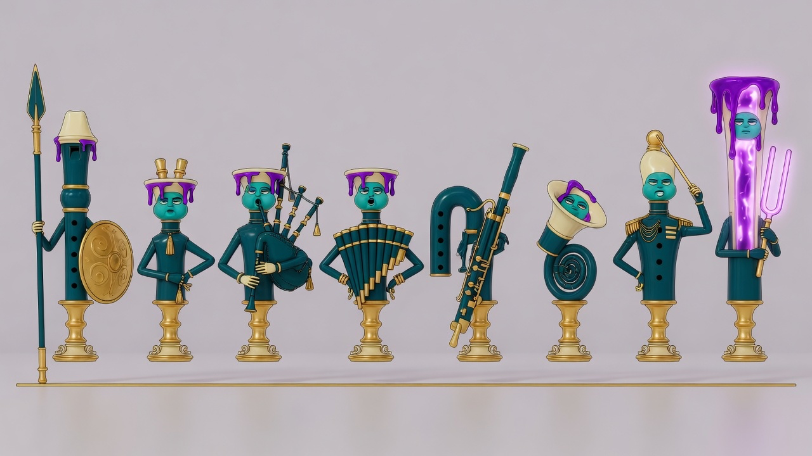

# Canon: lacquer_reed

Concept art the owner accepted in the Review Table (`python3 tools/review/review.py canon <batch>`). Each entry gives the
image, the verdict, the note, the prompt, the seat that made it, the batch and the date. Start 3D work from these.
Entries between the `canon:item` markers are rewritten by the next run; write anything else outside them.

<!-- canon:item art_r3/lacquer_reed_capital file=lacquer_reed_capital.png -->
## Chimewater, as a place

- **image:** `lacquer_reed_capital.png`
- **verdict:** Good
- **note:** none
- **prompt:** Use case: stylized-concept. Asset type: wide cinematic capital-city concept art for a 3D fantasy strategy game. Primary request: Chimewater as a lived-in marsh capital, not a fortress game piece. An inhabited settlement spreads across dark violet-black water among tall reeds under the Held Sun: circular timber boardwalk neighborhoods, stilt houses with glossy teal lacquer walls and ivory ceramic roofs, busy markets, boat landings, gardens of turquoise reeds, families and instrument-bodied Reed people sharing the walkways. Enormous organlike wind towers rise from the marsh in varied forms—recorder shafts, curved horn bridges, bassoon chimneys, conch listening halls—built into civic architecture rather than repeated pipes. Wind turns the whole city into an instrument: violet breath-light travels between towers, ivory bells catch the low sun, water ripples in concentric chords. At the heart stands a broad resonant pool encircled by inhabited halls and bridges, not an empty arena. Cinematic elevated view close enough to feel street life, wide layered depth, low golden Held Sun, glowing violet shadows. Match glossy deep teal lacquer, ivory ceramic, violet resin and brass. Bright colourful original high fantasy, dark but not grim, painterly concept art with clean cel-shaded silhouettes. No text, letters, captions, signs, labels, musical notation, logos, watermark or signature. Avoid generic European castle, empty fort, modern city, repeated cylinders, recognizable IP.
- **seat:** codex
- **batch:** art_r3
- **date:** 2026-10-07
<!-- /canon:item -->

<!-- canon:item art_r3/lacquer_reed_chord file=lacquer_reed_chord.png -->
## A chord struck in battle

- **image:** `lacquer_reed_chord.png`
- **verdict:** Good
- **note:** none
- **prompt:** Use case: stylized-concept. Asset type: wide cinematic battle concept art for a 3D fantasy strategy game. Primary request: A chord struck in battle by the Lacquer Reed. In the left and center foreground, several clearly different instrument-bodied units sound together in ordered ranks: recorder scouts and shawm infantry forward, a bassoon heavy in the front rank, bagpipe bellows swelling, panpipes in a second rank, a spiral conch monster, and a grand double-belled leader conducting. Their glossy teal lacquer bodies, ivory bells, violet resin glow and brass limbs match the established faction. Show the combined chord as three coherent visible pressure forms—teal wind ribbons, concentric ivory shock rings and violet resonant facets—interlocking into one precise wave, not random magic. On the right, an enemy formation is affected in an intelligible way: spearpoints and shields vibrate out of alignment, soldiers stagger and their orderly line opens into a clean gap, while bodies remain unharmed enough for dark-but-not-grim tone. Marsh edge battlefield under low golden Held Sun, bold readable composition, bright colourful high fantasy, painterly cel-shaded concept art, thick clean silhouettes and saturated color. The visual must communicate coordinated instruments creating a tactical combo. No text, letters, captions, labels, diagrams, musical notes or notation, logos, watermark or signature. Avoid generic soundwave UI, modern speakers, gore, recognizable IP.
- **seat:** codex
- **batch:** art_r3
- **date:** 2026-10-07
<!-- /canon:item -->

<!-- canon:item art_r3/lacquer_reed_section file=lacquer_reed_section.png -->
## The wind section, model sheet

- **image:** `lacquer_reed_section.png`
- **verdict:** Good
- **note:** none
- **prompt:** A wide model sheet of eight full-body figures in one row with clear gaps, feet on one baseline, plain warm-grey ground, empty background, three-quarter view from slightly above. Every figure keeps the Lacquer Reed body: glossy deep-teal lacquer, thin gold-jointed arms, a round gilded foot, and one living face inside a bone-white bell with a drip of violet resin. No clothing and no second head. Each body is a different wind instrument. Left to right: a tall bass recorder with a calm woman's teal face and a short white three-hole reed held upright; a straight recorder soldier with an oval shield and a reed spear; a flared shawm body with a short blade; a bagpipe whose torso is a bellows with three drone pipes rising behind the bell; a figure whose chest is a fan of panpipes; a tall folded bassoon of two tubes joined in a U; a wide coiled horn; and a grand figure whose bell is flooded with violet light, glowing violet eyes, holding a two-pronged tuning fork. Bright cel-shaded, thick black outlines, flat saturated colour. No text, no letters, no musical notes. Edited from the round-2 lineup and the two ruler portraits so the bell, the lacquer and the Pale Note's fork would hold.
- **seat:** grok
- **batch:** art_r3
- **date:** 2026-10-07
<!-- /canon:item -->

<!-- canon:item art_r3b/lacquer_reed_chord file=lacquer_reed_chord__grok.png files=lacquer_reed_chord__grok.png,lacquer_reed_chord__codex.png -->
## A chord struck in battle, fused

- **verdict:** Good with changes
- **kept:** 2 takes (a fusion: the note says what to take from each)
- **note:** i love all of the different variations each came up with - this could be a really fun faction
- **batch:** art_r3b
- **date:** 2026-10-08

### Take 1 (grok)

- **image:** `lacquer_reed_chord__grok.png`
- **seat:** grok
- **prompt:** A grand battle painting: a Lacquer Reed army of instrument-bodied units sounding a chord together against an Aurel Crown line of blue-and-gold human soldiers. Keep the Grok instrument-bodies: cream bell-heads with teal faces, glossy teal lacquer pipes, gold-jointed arms, gilded feet, panpipe fans, coiled horns, folded bassoons, bagpipe bellows, recorders with shields. Keep Codex's grand army scale and spectacular sound effects: huge concentric gold and white shock rings, visible standing waves, a wall of sound slamming the Crown line so spears snap and soldiers stagger backward. The chord's effect is readable as a shockwave that blunts and throws the enemy. Held Sun golden-hour light, marsh-green ground, cinematic wide view. Cel-shaded lean, colourful, dark but not grim. No text, letters, banners with writing, or labels. Edited from the Codex chord (army scale and rings) and the Grok chord and section (instrument-bodies).

### Take 2 (codex)

- **image:** `lacquer_reed_chord__codex.png`
- **seat:** codex
- **prompt:** Use case: stylized-concept. Asset type: wide 16:9 cinematic battle concept art for a stylized 3D fantasy strategy game. Primary request: A Lacquer Reed chord struck in battle, fused from both supplied battle references. Preserve the Codex reference's grand army scale, layered ranks, forceful action, spectacular readable sound effects, and golden-hour battlefield; use the Grok reference's strange instrument-as-body designs, especially coil, bell-cone, bellows, folded bass, and panpipe fan, but give them coherent gold articulation and alignment. Scene/backdrop: marsh-edge battlefield under the low Held Sun, reeds and shallow water in foreground, a vast Lacquer Reed formation on the left confronting an Aurel Crown shield-and-spear line in royal blue and gold on the right. Subject: foreground ensemble of five distinct Reed voices sounding together: a compact coiled Horn, a tall flared Shawm, a shield-like straight Reedward recorder, a folded double-back Crook bass, and a fan-bodied Hole-singer behind them. Their glossy deep-teal lacquer bodies are the instruments, with gold-jointed arms and legs, gilded feet, and living dark-teal faces nested in bone-white bells rimmed with violet resin. Many more varied instrument units fill the ranks behind. The chord manifests as one coherent wall of nested turquoise and violet pressure rings woven with bright golden harmonics, visibly compressing the entire blue-and-gold enemy line: banners and spear shafts bend backward, shields cant, soldiers stagger as a synchronized rank-wide force. Make the tactical effect unmistakable without depicting gore or crystal magic. Style/medium: bright colorful high fantasy concept art with cel-shaded lean, clean bold silhouettes and outlines, painterly atmospheric depth, original and dark but not grim. Composition/framing: dynamic wide panorama, Reed army dominates left two-thirds, Crown line on right, diagonal sound wall connecting them, clear foreground heroes plus grand ranks fading into distance. Lighting/mood: spectacular low golden sunlight, triumphant uncanny music made physical. Color palette: deep teal, bone white, violet resin, cyan sound, warm gold; opposing royal blue and gold. Constraints: instrument bodies rather than people holding instruments; chord reads as sound pressure; several classes visibly cooperate. Avoid: text, letters, captions, labels, UI, watermarks, signatures, recognisable IP, real religious symbols, modern instruments, gore.
<!-- /canon:item -->

<!-- canon:item art_r3b/lacquer_reed_motion file=lacquer_reed_motion__grok.png files=lacquer_reed_motion__grok.png,lacquer_reed_motion__codex.png -->
## How they move: floating on sound

- **verdict:** Good with changes
- **kept:** 2 takes (a fusion: the note says what to take from each)
- **note:** the bodies of codex and the subtler floating effect of grok.
- **batch:** art_r3b
- **date:** 2026-10-08

### Take 1 (grok)

- **image:** `lacquer_reed_motion__grok.png`
- **seat:** grok
- **prompt:** A wide motion-study of one Lacquer Reed unit shown three times left to right on a plain warm-grey ground: at rest, gliding, and sounding in attack. The unit is a glossy deep-teal lacquer coiled horn with a cream bell-head, a living teal face in the bell, gold-jointed articulated arms, violet resin at the rim, and a single gilded pedestal foot. At rest the gold foot floats a finger-width off the ground on faint concentric standing-wave rings of gold light. In the middle it glides left to right, trailing ripple rings on the ground like a boat wake. On the right it sounds: the rings flare into bright gold and violet shock discs, a cone of visible sound bursts from the bell, the gold arms thrown wide. Then edited: Keep this three-beat motion of the coiled horn. Make the middle pose clearly a glide: the body leans forward, the gilded foot trails a longer wake of gold ripple-rings across the ground. Keep rest on the left with small standing-wave rings holding the foot just off the ground, and attack on the right with flared gold-and-violet shock discs. Same teal coil body, cream bell, teal face, gold-jointed arms throughout. Plain grey ground. Cel-shaded high fantasy, thick outlines, even studio light. No text, letters, labels or captions.

### Take 2 (codex)

- **image:** `lacquer_reed_motion__codex.png`
- **seat:** codex
- **prompt:** Use case: stylized-concept. Asset type: wide 16:9 motion study and animation direction sheet for a stylized 3D fantasy strategy game. Primary request: Show how Lacquer Reed units float on sound. Use both supplied section references to fuse Grok's clean instrument-body idea with Codex's gold-jointed articulated limbs and polished class readability. Subject: the same single Horn unit repeated exactly three times from left to right, with ample gaps: (1) at rest, (2) gliding forward, (3) sounding in attack. It is a compact deep-teal lacquer coil whose upper body ends in a bone-white flared bell containing a living dark-teal face in violet resin, with small articulated gold arms and one central gilded bell-shaped foot. At rest, a precise set of pale cyan and violet standing-wave rings beneath the foot holds it visibly a handspan above the ground. While moving, the foot stays airborne, body leans forward, articulated arms counterbalance, and compressed concentric sound ripples trail behind along the ground. During attack, the bell-face opens toward the right and a powerful nested cone of turquoise-and-violet pressure rings erupts forward while the support rings below flare larger and brighter. The body must remain recognizably identical in all three poses. Style/medium: bright colorful high fantasy game concept art, cel-shaded lean, thick clean outlines, flat saturated colors, polished animation model study. Composition/framing: three equal left-to-right stages on one plain warm-gray ground plane, same camera and scale, full figures uncropped, no panels or dividing lines, motion communicated purely pictorially. Lighting/mood: even studio light; analytical but spectacular. Color palette: deep teal lacquer, warm gold joints, bone-white bell, violet resin, luminous cyan-violet sound waves. Constraints: sound waves visibly support the hovering gilded foot; no contact with ground in any pose; readable progression rest to glide to attack. Avoid: text, letters, numbers, arrows, captions, labels, UI, diagram symbols, watermarks, signatures, extra characters, recognizable IP, real religious symbols.
<!-- /canon:item -->

<!-- canon:item art_r3b/lacquer_reed_section file=lacquer_reed_section__codex.png files=lacquer_reed_section__codex.png,lacquer_reed_section__grok.png -->
## The wind section, fused

- **verdict:** Good with changes
- **kept:** 2 takes (a fusion: the note says what to take from each)
- **note:** Take the bodies and shape, but let's give them that floating effect from the more recent changes
- **batch:** art_r3b
- **date:** 2026-10-08

### Take 1 (codex)

- **image:** `lacquer_reed_section__codex.png`
- **seat:** codex
- **prompt:** Use case: stylized-concept. Asset type: wide 16:9 faction model sheet for a stylized 3D fantasy strategy game. Primary request: Create the Lacquer Reed wind section as a fused character model sheet. Use both supplied section references: preserve the Codex reference's crisp articulation, mechanical gold joints, distinct legs and arms, polished finish, readable class silhouettes, and consistent baseline; fuse in the Grok reference's bold instrument-bodies where the entire torso is unmistakably the wind instrument, including bell-cone faces, coil, bellows, folded bass, and panpipe fan. Subject: exactly eight full-body figures, separated with clean gaps and arranged on one shared baseline at consistent scale: Reedward recorder wall; Shawm with flared double-reed body; Skirl with round bagpipe-bellows torso and three drones; Hole-singer with fan of open panpipes; Crook as a wide doubled-back folded bass bore; Horn as a compact lacquer coil; Chormeister as a cornett with raised thin gold baton; and the Pale Note at the end, a taller bone-white bell flooded with luminous violet, holding a tuning fork. Each ordinary unit has glossy deep-teal lacquer, gold articulated arms and legs, one gilded bell-shaped foot or paired articulated gilded feet, and one living dark-teal face nested inside a bone-white bell with violet resin at the rim. Instrument structure forms the body, never merely held as a prop. Style/medium: bright colorful high fantasy game concept art, cel-shaded lean, flat saturated colors, thick clean dark outlines, one hard-edged shadow and highlight, polished original design, dark but not grim. Composition/framing: panoramic lineup, three-quarter strategy-camera view slightly above, all figures fully visible and uncropped, plain warm light-gray ground and empty neutral background. Lighting/mood: even studio light, confident and strange. Color palette: deep teal lacquer, warm gold joints, bone-white bells, violet resin and glow. Constraints: strong instantly readable silhouettes; mechanically plausible articulation; no living human bodies; no repeated generic tube shapes; no overlap. Avoid: text, letters, numbers, labels, captions, dividers, UI, watermarks, signatures, recognizable IP, real religious symbols.

### Take 2 (grok)

- **image:** `lacquer_reed_section__grok.png`
- **seat:** grok
- **prompt:** A wide character model sheet of the Lacquer Reed, a high-fantasy army whose bodies are wind instruments. Eight figures in one even row on a shared baseline, plain warm-grey studio ground, empty background, even bright light. Each figure is a glossy deep-teal lacquer instrument with gold joints, a cream bell-head, a living teal face inside the bell, violet resin dripping from the rim, thin gold-jointed articulated arms, and a gilded pedestal foot. Distinct class silhouettes left to right: a tall straight recorder holding a spear and round gold shield; a flared shawm; a bagpipe whose torso is a leather-teal bellows with three drone pipes; a figure whose chest is a fan of panpipes; a folded bassoon whose bore doubles back in a wide U; a coiled spiral horn; a cornett commander raising a thin gold baton; the Pale Note, taller, its bell flooded with glowing violet, holding a tuning fork. Then edited: Keep this exact eight-figure lineup and every instrument silhouette. Do not add extra faces. Change only the lower body of each figure: replace walking legs with a single attached gilded candlestick-foot that is part of the same body, like a brass pedestal fused to the teal pipe, hovering a finger-width above the ground. Arms stay gold-jointed and articulated. One shared baseline, plain grey ground. No detached bases, no extra heads. Cel-shaded lean, thick clean outlines, flat saturated colour. No text, letters, labels, captions or watermarks.
<!-- /canon:item -->
