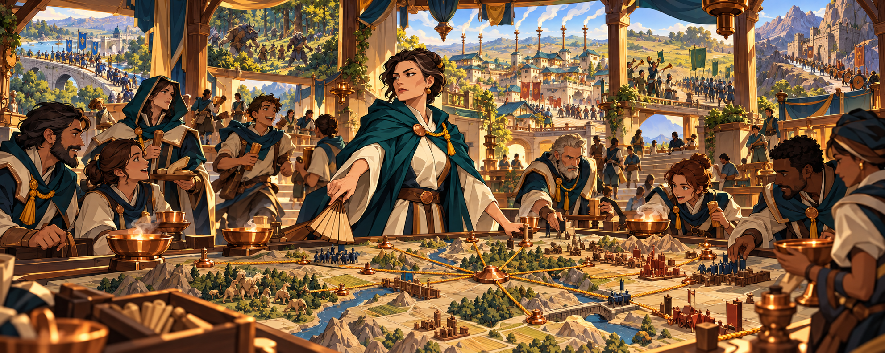

# Canon: veiled_table

Concept art the owner accepted in the Review Table (`python3 tools/review/review.py canon <batch>`). Each entry gives the
image, the verdict, the note, the prompt, the seat that made it, the batch and the date. Start 3D work from these.
Entries between the `canon:item` markers are rewritten by the next run; write anything else outside them.

<!-- canon:item art_r3/veiled_table_key file=veiled_table_key.png -->
## The war room reads the table

- **image:** `veiled_table_key.png`
- **verdict:** Good
- **note:** none
- **prompt:** Use case: stylized-concept. Asset type: wide cinematic faction key art for a 3D fantasy strategy game. Primary request: The Veiled Table's genius moment inside Commonroof's open war room under the low Held Sun. A large roofed-but-open civic table court sits among linked cream-plaster houses, dark teal roof-shields, balconies and bridges. At the center, First Host Nella in dark teal mantle and cream dress stands over one enormous blank carved relief map table with no writing, her wooden map fan snapping shut at the instant many predictions prove true. Around her, diverse human couriers, cooks, codebreakers, witnesses and Pact Heralds simultaneously receive evidence from every rival war: runners arrive through several doors carrying unmarked tokens; marigold cords pull taut across the relief map; copper bowls flare; seven tall smoke standards outside send distinct curls; hinged wooden army miniatures tip into exactly the positions Nella anticipated. Through open arches and elevated balconies, distant parts of Halfmade appear as small simultaneous vignettes beneath the Held Sun—a blue-and-gold Crown column choosing a bridge, beastfolk entering forest, Candlewake taking a town, Reed instruments meeting an army, Kilnborn holding a tiled pass—yet these are visual sightline echoes, not floating screens or magic text. The room reacts with contained exhilaration: knowing looks, hands landing on the correct tokens, one courier laughing in disbelief. The composition must instantly say that this faction correctly read everyone's plans at once, including wars far away. Palette dark teal, cream plaster, copper, warm wood, marigold cord, deep indigo shadows and golden light. Bright colourful high fantasy, dark but not grim, cinematic painterly cel-shaded concept art, bold readable silhouettes, original civic intelligence culture. No text, letters, captions, labels, numbers, map writing, symbols, UI, logos, watermark or signature. Avoid crystal balls, floating holograms, assassin guild, generic wizard council, real religious symbols, recognizable IP.
- **seat:** codex
- **batch:** art_r3
- **date:** 2026-10-07
<!-- /canon:item -->
