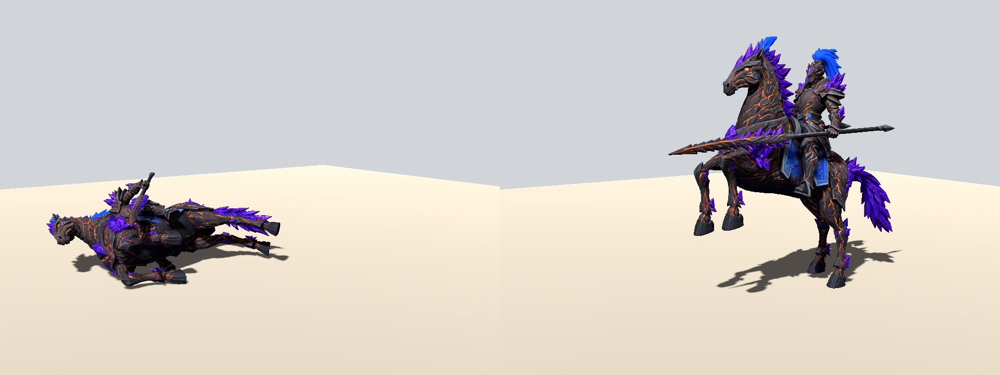

# Rig lab

A testing ground for the future model pipeline: **one rigged model per unit, animated by our own clips written as code**, in place of four separately generated pose models. It isn't wired into the game. It's here so that when ascendant is worth the investment, we start from a working lab instead of from zero.

Started 2026-10-11, when Alex made one Bake3D model (the Living Iron knight in crystal armour). Bake3D's model quality beat Ludo's by a wide margin, but its built-in animations didn't, so we wrote our own.



`media/iron_knight_anims.mp4` has the first pass of all four clips: gallop ×4, then rear + lance strike, idle, and fall.

## Run it

```bash
godot --path . -s tools/rig_lab/lab.gd --always-on-top --resolution 960x720 -- --clip=gallop --frames=24 --yaw=55
```

- `--clip`: `rest`, `gallop`, `strike`, `idle`, `fall`
- `--frames`: frames in one loop of the clip. `--yaw`: camera angle around the model, in degrees (90 is a side view)
- `--glb`: model path; the default is `tools/rig_lab/models/iron_knight.glb`
- `--out`: where frames go (default `/tmp/rig_lab`); each clip lands in `<out>/<clip>/NNNN.png`
- Turn frames into a video with `ffmpeg -framerate 24 -i <out>/gallop/%04d.png -pix_fmt yuv420p gallop.mp4`

Models live in `models/`, which is gitignored and carries a `.gdignore`. That's because the knight is 28 MB, and the lab loads GLBs at runtime through `GLTFDocument`, so they never need a Godot import. The original is in Alex's `~/Downloads/bak3d/iron_knight.glb`.

On the Mac, windowed runs need `--always-on-top`, or the render never finishes when other windows cover it (see the shots harness).

## What we learned

- **The rig:** the Bake3D export is 150k triangles, 28 MB, and one skinned mesh with 51 named bones and no animations.
  - Horse: `hips`, `spine0`, `chest`, `neck`, `head`, `earL/R`.
  - Front legs: `thighL0/R0` → `shin` → `foot` → `toe`. Hind legs: `thighL1/R1` → ….
  - Tail: `tail0-3`.
  - Rider: `riderPelvis` → `riderTorso` → `riderNeck/Head`, `shoulder/upperArm/forearm/hand/finger L/R`, `riderThigh/Shin/Foot/Toe L/R`.
  - `lance` hangs under `handL`, and `motion_root` is the root.
  - The model faces +Z, with Y up and feet at y=0.
- **The clips are code:**
  - `rot(bone, world_axis, degrees)` turns a bone about a world axis. Each clip is a function of `t` from 0 to 1.
  - Whole-body moves (the rear, the roll onto its side) pivot the model about a ground point with `_pivot()`.
  - On the X axis, a negative angle swings a leg forward (toward +Z).
- **Why this beats an online tool:** the clips are versioned and reviewable, and one edit updates every model of that body type, so they get better over time. We can also write moves no tool offers: a couched-lance charge, a shield-wall brace.
  - **The limit:** hand-written motion plateaus below motion capture for humans. If Bake3D's humanoid rig maps onto Godot's `SkeletonProfileHumanoid`, the humanoids can retarget free motion-capture libraries. Horses and beasts stay hand-written.

## How it would reach the game

Battles draw figures as static pose meshes in MultiMeshes (`world3d/battle_figures.gd`, `world3d/models.gd`), so skinned meshes can't go in as-is. The plan:

1. **Bake** each pose (ready / march / strike / fallen) from the rig into a static GLB, then slim it to about 5k triangles and 512 px textures (`tools/ludo/glb_slim.py`). All four poses then come from one model, so they stop drifting the way four separate generations do.
2. Optionally bake 6-8 frames of the gallop and strike as extra poses (a flipbook), so units move in battle.
3. Keep the live skinned model for close-ups: rulers, the codex, unit cards.

## Cost estimate (10-11)

- **Models:** about 65 (6 factions plus independents; roughly 10 each: 6 units, 2 rulers, about 2 variant looks).
  - Each is 55 Bake3D credits on High plus 25 for the rig, so about 120 credits with retakes.
  - About 7,800 credits in total, which is **about $300** (Studio plan, $79/month for 2,100 credits). Always buy the rig and skip Bake3D's animations.
- **Animation:** written per body type, not per unit.
  - About 6-8 body types: humanoid, horse and rider, four-legged beast, winged, construct, and odd bodies like the Candlewake wax and Reed instrument-bodies.
  - About 6 clips each (idle, march, strike, hit, fall, cheer) plus weapon tweaks per unit.
  - Roughly 10-15 builder sessions, plus 1-2 for the baker and slimming step.
  - The real limit is review rounds on the feel, not money.

**When:** once the game is proven fun and worth investing in (Alex, 10-11). Until then, Ludo carries the pipeline.
